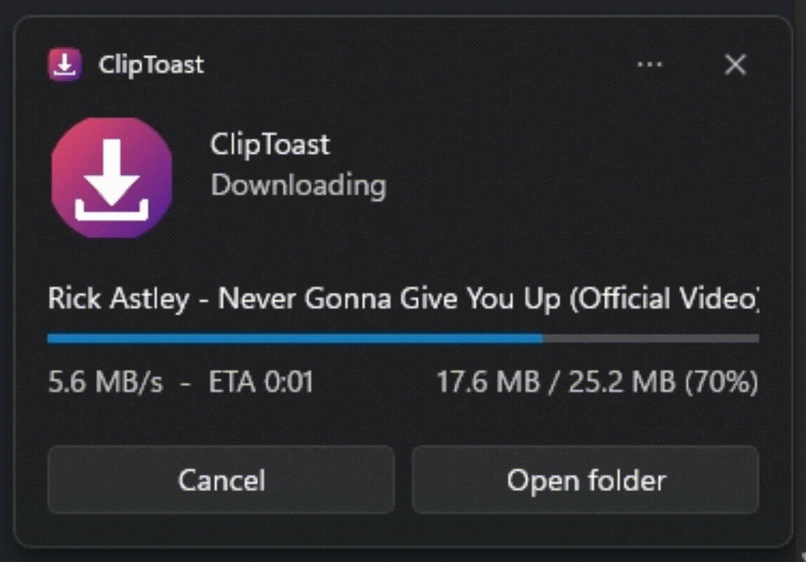
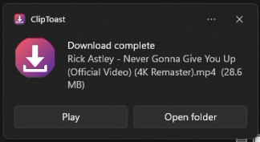

# ClipToast

[](https://github.com/2harshpandey/ClipToast)
[](https://opensource.org/licenses/MIT)
[](https://github.com/2harshpandey/ClipToast/releases)
[](https://github.com/2harshpandey/ClipToast/stargazers)
[](https://alternativeto.net/software/cliptoast/)
[](https://github.com/yt-dlp/yt-dlp)
[](https://ffmpeg.org/)

**ClipToast** is a lightweight, background media downloader for Windows 11 and 10. Copy any media link from YouTube, Instagram, TikTok, Reddit, or 1,000+ sites, press a shortcut, and ClipToast downloads and converts it with native interactive Windows toast notifications.

It also solves a unique problem other downloaders can't: **downloading Instagram photo posts with background music and synthesizing them into ready-to-share MP4 videos.**

<div align="center">
  
  <p><em>Real-time download progress, transfer speed, estimated time remaining, and controls inside native Windows toast notifications.</em></p>
</div>

---

## Highlights

- **Instant Shortcuts**:
  - `Ctrl + Alt + G`: Download video as a universal H.264/AAC MP4 with creator attribution and stream-copy speed (~1s post-processing).
  - `Ctrl + Alt + A` or `Ctrl + Alt + M`: Extract 320kbps MP3 audio with embedded album artwork.
- **Interactive Windows Toasts**: Track live progress, transfer speed, and ETA. Includes **Cancel**, **Play**, and **Open Folder** actions directly in the notification.
- **Instagram Photo + Music Synthesizer**: Automatically merges still photos or carousels with their attached audio track into a WhatsApp-compatible MP4 video matching the song's exact mobile app duration.
- **Clean Creator Filenames**: Files are saved with creator attribution (e.g. `Creator - Title.mp4`) with path-safe length capping and collision prevention (`(1)`, `(2)`).
- **Account Cookies Support**: 1-click automatic detection for Firefox and smart multi-site `cookies.txt` merging for Brave, Chrome, and Edge to access private or account-locked media.
- **Zero-Friction Setup**: Per-user install (no admin rights needed), automatic tool configuration (yt-dlp, FFmpeg, Deno), and cryptographically signed auto-updates.

---

## Supported Sites

Powered by [yt-dlp](https://github.com/yt-dlp/yt-dlp), ClipToast supports media extraction from over 1,000 websites:

| Platform | Capabilities |
| :--- | :--- |
| **YouTube** | Up to 8K, Shorts, YouTube Music, and automatic `.srt` captions |
| **Instagram** | Reels, Stories, carousels, and photo posts with music synthesis |
| **TikTok** | Watermark-free high-definition video downloads |
| **Reddit** | Merges separated video and audio streams into a unified MP4 |
| **Twitter / X** | Direct video clips and GIF extractions |
| **Facebook & Pinterest** | Public videos, reels, and video pins |
| **SoundCloud & Bandcamp** | High-bitrate audio saved directly as tagged MP3s |

---

## Instagram Photo Posts with Music (Photo + Audio to MP4)

### The Challenge
When a photo post or carousel with background music is shared on Instagram, Instagram streams the still JPEG image and audio track separately — it **never creates a video file**. Standard downloaders and `yt-dlp` fail with `There is no video in this post` or download only a silent image.

### How ClipToast Fixes It
ClipToast automatically extracts the uncompressed high-res photo (`.jpg`) and the background music stream (`.m4a`), then uses FFmpeg to synthesize them into a universal MP4:
```bash
ffmpeg -loop 1 -i image.jpg -i audio.m4a -c:v libx264 -tune stillimage -preset ultrafast -crf 20 -pix_fmt yuv420p -c:a aac -b:a 192k -shortest "ClipToast Downloads/Post.mp4"
```
- **Video Mode (`Ctrl + Alt + G`)**: Generates an MP4 video matching the exact audio length, ready to share on WhatsApp or Discord.
- **Audio Mode (`Ctrl + Alt + A`)**: Extracts just the song as a clean 320kbps MP3 with the photo embedded as cover art.

---

## Account Cookies & Private Media Setup

For private accounts, age-restricted YouTube videos, or Instagram audio streams that require a login session:

### Option 1: Firefox (Automatic)
In ClipToast Settings, select **Firefox (auto-detect)** from the dropdown. ClipToast reads your session directly without extensions or manual steps.

### Option 2: Brave, Chrome, or Edge (cookies.txt)
Modern Chromium browsers on Windows lock cookies with App-Bound Encryption. To use your login session in ClipToast:
1. In your browser, install the free extension [Get cookies.txt LOCALLY](https://chromewebstore.google.com/detail/get-cookiestxt-locally/cclelndahbckbenkjhflpdbgdldlbecc) from the Chrome Web Store.
2. Visit [instagram.com](https://www.instagram.com) or [youtube.com](https://www.youtube.com) while logged in.
3. Click the extension icon in your toolbar and click **Export** (saves `cookies.txt`).
4. In ClipToast Settings, click **Import / Merge...** (or click **? Guide**). ClipToast automatically merges cookies across multiple sites (Instagram, YouTube, etc.) into one combined file without overwriting.

---

## Installation & Download

### Windows Installer
1. Download [ClipToastSetup-v1.1.2.exe](https://github.com/2harshpandey/ClipToast/releases/latest/download/ClipToastSetup-v1.1.2.exe) from [Releases](https://github.com/2harshpandey/ClipToast/releases).
2. Run the installer (no administrator privileges required).
3. The installer configures all media tools (`yt-dlp`, `FFmpeg`, `Deno`) automatically and adds ClipToast to your system tray.

*(If Windows SmartScreen appears on first run because ClipToast is independent and open-source, click **More info** $\rightarrow$ **Run anyway**).*

### Portable Version
1. Download [ClipToast-v1.1.2-portable.zip](https://github.com/2harshpandey/ClipToast/releases/latest/download/ClipToast-v1.1.2-portable.zip).
2. Extract the archive anywhere and run `ClipToast.exe`.

---

## How to Use

1. Copy any video, reel, post, or audio link to your clipboard.
2. Press a shortcut:
   - **`Ctrl + Alt + G`**: Download Video (MP4)
   - **`Ctrl + Alt + A`** or **`Ctrl + Alt + M`**: Download Audio (MP3)
   - Or click the ClipToast tray icon near your Windows clock.
3. A Windows notification appears showing download progress. Once finished, click **Play** or **Open Folder**.

<div align="center">
  
  &nbsp;&nbsp;
  
</div>

---

## Settings

Right-click the ClipToast tray icon near your clock and select **Settings**:
- **Download folder**: Choose where media files are saved.
- **Maximum video quality**: Cap resolution at 1080p, 720p, 1440p, or best available (up to 4K/8K).
- **Subtitles**: Automatically download `.srt` captions when available.
- **Cookies**: Auto-detect Firefox session or import `cookies.txt` with one click.
- **Dependencies**: View status or reinstall media engines (`yt-dlp`, `FFmpeg`, `Deno`) with one click.
- **Auto-Updates**: Automatically checks for signed app updates in the background.

---

## Security & Verification

- **Antivirus Clean**: Scans 100% clean on Microsoft Defender, Kaspersky, BitDefender, Avast, and Sophos.
- **Cryptographic Auto-Updates**: All updates are signed with an RSA key and verified prior to installation.
- **Privacy First**: No tracking, telemetry, or third-party analytical requests.
- **Full Source Available**: Auditable and open for community contribution.

---

## License

This project is licensed under the [MIT License](LICENSE). Built on top of [yt-dlp](https://github.com/yt-dlp/yt-dlp), [FFmpeg](https://ffmpeg.org/), and [Deno](https://deno.land/).
