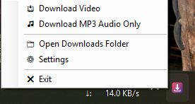

# ClipToast - Seamless Windows Clipboard Media Downloader

[](https://github.com/2harshpandey/ClipToast)
[](https://opensource.org/licenses/MIT)
[](https://github.com/2harshpandey/ClipToast/releases)
[](https://github.com/yt-dlp/yt-dlp)
[](https://ffmpeg.org/)
[](https://github.com/2harshpandey/ClipToast)

> **ClipToast** is a lightning-fast, zero-friction background media downloader for Windows 11 and Windows 10. Copy any video or music link, press a global hotkey or click the tray icon near your clock, and ClipToast grabs the media in the background with interactive Windows toast notifications.

<br/>

<div align="center">
  
  <p><em>Real-time download progress bar, speed, ETA, and 1-click controls right inside Windows toast notifications.</em></p>
</div>

---

## ⚡ Highlights

- ⌨️ **Dual Global Hotkeys**:
  - **<kbd>Ctrl</kbd> + <kbd>Alt</kbd> + <kbd>G</kbd>**: Downloads highest quality video converted to universal WhatsApp-ready MP4.
  - **<kbd>Ctrl</kbd> + <kbd>Alt</kbd> + <kbd>A</kbd>** *(or **<kbd>Ctrl</kbd> + <kbd>Alt</kbd> + <kbd>M</kbd>***)*: Extracts clean **320kbps MP3 Audio** with embedded cover art and metadata (perfect for songs, podcast clips, and Lo-Fi mixes).
- 🕒 **System Tray Icon (Taskbar Clock)**:
  - **Left-Click**: Instantly downloads the media link currently copied in your clipboard.
  - **Right-Click Menu**: Quick access to Video Download, MP3 Extraction, Downloads Folder, Settings, and Exit.
- 🔔 **Interactive Toast Notifications**: Live progress bar, download speed, ETA, and media title.
  - **Cancel Ongoing Downloads**: Abort active downloads directly from the toast notification in 1 click.
  - **Instant Play & Open Folder**: Enjoy downloads immediately with dedicated "Play" and "Open folder" buttons.
- 💬 **Smart Subtitles with Fallback**: Automatically grabs synchronized `.srt` captions when available. If captions are unavailable or rate-limited by the platform (such as YouTube HTTP 429), the video still downloads completely without interruption and clearly notes subtitle status.
- 🛡️ **1-Click Anonymous Error Reporting**: If an unrecoverable failure occurs, the notification provides a **"Report issue"** button that pre-fills a GitHub issue with anonymous diagnostic info (OS version, yt-dlp version, sanitized error logs—strictly zero PII).
- 🕒 **System Tray Icon with Auto-Recovery**: Sits quietly near your clock. If you ever exit the tray icon, restore it instantly via **Settings -> Start Tray Now**, the Start Menu, or automatically the next time you trigger any download.
- 📱 **WhatsApp & Universal Playback Guarantee**: Automatically remuxes or converts videos to **MP4 (H.264 + AAC + yuv420p + faststart)** so they play natively on WhatsApp Web/Desktop, iPhone, Android, and Smart TVs without "unsupported format" errors.
- 🎨 **SDR Color Preservation**: Avoids washed-out HDR-to-SDR conversions by preferring high-bitrate SDR streams.
- 🔒 **Zero-Admin Installer**: Installs entirely in user space (`%LOCALAPPDATA%\ClipToast`) with no UAC prompts and registers standard Windows Add/Remove programs integration.
- 🛡️ **Cryptographically Signed Auto-Updates**: Built-in RSA-SHA256 signature verification guarantees tamper-proof background updates directly from GitHub Releases.
- 🍪 **Login & Cookie Integration**: Easily pass cookies from Firefox, Chrome, Edge, or Brave via Settings to access private or age-restricted content.

---

## 🌐 1,000+ Supported Sites

Because ClipToast is powered by `yt-dlp`, it supports virtually every media site on the web out of the box:

| Platform | What ClipToast Delivers |
| :--- | :--- |
| **YouTube** | Up to 4K/8K, YouTube Shorts, YouTube Music, and official/auto captions (.srt). |
| **Instagram** | High-res Reels, video posts, and carousel clips. |
| **TikTok** | Crisp video downloads **without watermarks**. |
| **Reddit** | Automatically merges Reddit's separated video + audio streams into a single unified MP4 (no silent videos). |
| **Twitter / X** | Direct MP4 extraction of clips and GIFs embedded in tweets. |
| **Pinterest & Facebook** | Recipe clips, DIY videos, and Facebook Watch reels. |
| **SoundCloud & Bandcamp** | High-fidelity audio extraction directly into tagged MP3s. |
| **Twitch & Vimeo** | Stream clips, VODs, and high-bitrate video. |

---

## 📥 Installation

You can install ClipToast in two ways:

### Option A: Setup Installer (Recommended)
1. Go to the [Releases](https://github.com/2harshpandey/ClipToast/releases) page.
2. Download **`ClipToastSetup-v1.1.exe`**.
3. Run the installer (no administrator privileges required).
4. Choose your preferred download folder (default: `Downloads\ClipToast`).
5. ClipToast will configure the media tools and sit quietly in your system tray.

> **💡 First-Time Windows SmartScreen Note:**  
> ClipToast is a free, open-source community utility without an expensive ($400/yr) corporate EV certificate. If Windows displays a blue *"Windows protected your PC"* prompt:  
> 1. Click **More info**  
> 2. Click **Run anyway**  
> *(ClipToast is verified clean against Microsoft Defender, Kaspersky, BitDefender, Avast, and CrowdStrike Falcon).*

### Option B: Portable Edition (Zero-Install)
If you prefer not to run an installer:
1. Download **`ClipToast-v1.1.0-portable.zip`** from [Releases](https://github.com/2harshpandey/ClipToast/releases).
2. Extract the archive to any folder (e.g. `C:\Tools\ClipToast` or your user folder).
3. Double-click `ClipToast.exe` (or run `ClipToast.exe --tray`) to start using it immediately!

---

## 🚀 How to Use

1. **Copy any media link** to your clipboard (YouTube, Instagram, TikTok, Reddit, etc.).
2. **Trigger the download**:
   - Press **<kbd>Ctrl</kbd> + <kbd>Alt</kbd> + <kbd>G</kbd>** for **Video (MP4)**
   - Press **<kbd>Ctrl</kbd> + <kbd>Alt</kbd> + <kbd>A</kbd>** (or **<kbd>Ctrl</kbd> + <kbd>Alt</kbd> + <kbd>M</kbd>**) for **Audio (320kbps MP3)**
   - Or click the **ClipToast tray icon** near the clock.
3. A Windows Toast Notification will track speed, progress %, and media encoding.
   - Click **"Cancel"** at any time to abort the download.
4. When finished:
   - Click **"Play"** to launch the file in your default player.
   - Click **"Open folder"** to highlight the file in Windows Explorer.

---

## ⚙️ Settings & System Tray Menu

<div align="center">
  
</div>

<br/>

Access quick media actions and settings anytime via the system tray icon near your clock (**Right-click -> Menu**) or Start Menu (**ClipToast Settings**):
- **Download Video**: Instantly grabs and converts the copied clipboard link to WhatsApp-ready MP4.
- **Download MP3 Audio Only**: Extracts high-fidelity 320kbps MP3 audio with cover art.
- **Open Downloads Folder**: Quick 1-click access to your downloaded media in File Explorer.
- **Settings**:
  - **Download folder**: Customize destination directory.
  - **Maximum video quality**: Cap resolutions at 1080p (recommended for speed) or leave unconstrained (up to 4K / 8K).
  - **Subtitles**: Toggle automatic subtitle (.srt) saving alongside video.
  - **System tray & Startup**: Run ClipToast near the Windows clock on startup, or click **"Start Tray Now"** anytime to immediately launch the tray icon.
  - **Browser login cookies**: Select your browser to access account-locked or Instagram-walled videos.
  - **Update preferences**: Toggle auto-updates or click **Check for updates** anytime.
- **Exit**: Cleanly exits the tray listener (automatically restored on your next hotkey download).

> **💡 Exited the tray icon?** You can restore it anytime in 3 effortless ways:
> 1. Open **ClipToast Settings** and click **Start Tray Now**.
> 2. Search for **ClipToast Tray** in your Windows Start Menu.
> 3. Press your normal hotkey (<kbd>Ctrl</kbd>+<kbd>Alt</kbd>+<kbd>G</kbd> / <kbd>Ctrl</kbd>+<kbd>Alt</kbd>+<kbd>A</kbd>) to download any link—ClipToast will automatically detect that the tray icon was closed and restore it quietly in the background!

---

## 🛠️ Architecture

```
ClipToast/
├── .github/                  # GitHub Community Standards & Issue Templates
│   ├── ISSUE_TEMPLATE/       # Bug report & feature request templates
│   └── pull_request_template.md
├── app/                      # Application runtime scripts and assets
│   ├── common.ps1            # Shared WinRT toasts, config management, signed self-update
│   ├── downloader.ps1        # Clipboard reader, yt-dlp orchestrator, FFmpeg WhatsApp-safe pipeline
│   ├── action.ps1            # Toast notification action dispatcher (Cancel, Play, Open folder)
│   ├── tray.ps1              # Lightweight Windows system tray notification area app & hotkeys
│   ├── install-tools.ps1     # Automated downloader for yt-dlp, FFmpeg, ffprobe, and Deno
│   ├── settings.ps1          # WinForms GUI for user preferences and manual updates
│   ├── update-public-key.xml # RSA public key for cryptographic update verification
│   ├── cliptoast.ico         # Notification & tray icon
│   ├── cliptoast.png         # Modern toast logo
│   └── version.txt           # App version manifest (1.1.0)
├── assets/                   # Visual documentation & preview media
│   ├── demo.gif              # Live toast download progress animation
│   └── tray-menu.png         # System tray context menu preview
├── release/                  # GitHub Release assets (built artifacts)
│   ├── ClipToastSetup-v1.1.exe       # Standalone installer wizard
│   ├── ClipToast-v1.1.0-portable.zip # Zero-install portable edition
│   ├── ClipToast-app-1.1.0.zip       # Cryptographically signed auto-update package
│   ├── latest.json                   # Cryptographic update manifest
│   └── RELEASE_NOTES_v1.1.0.md       # Formatted release notes
├── src/
│   └── launcher/
│       ├── Program.cs        # C# source for the ClipToast launcher
│       └── ClipToast.exe     # Compiled native GUI launcher (subsystem:windows)
├── cliptoast.ico             # High-resolution application icon
├── cliptoast.png             # Modern notification logo
├── installer.nsi             # NSIS installer definition (outputs to release\)
├── make-update.ps1           # Release packaging and RSA signing tool
├── CODE_OF_CONDUCT.md        # Contributor Covenant Code of Conduct
├── CONTRIBUTING.md           # Contribution guidelines & dev build setup
├── SECURITY.md               # Security policy & vulnerability reporting
├── LICENSE                   # MIT License
└── README.md
```

### Dependencies
Runtime tools (`yt-dlp`, `FFmpeg`, `ffprobe`, `Deno`) are fetched directly from their official GitHub releases and reside in `%LOCALAPPDATA%\ClipToast\bin`.

---

## 🛡️ Antivirus, SmartScreen & False Positive Transparency

ClipToast is a 100% free, community-driven open-source project without a paid corporate EV code-signing certificate ($400+/year). 

When a brand-new version is released, automated cloud machine-learning scanners (e.g. SmartScreen, generic AI heuristics) have never encountered the file's hash before. Because of this, certain automated engines may temporarily classify newly compiled installers as "Anomalous" or "Unknown Publisher" until sufficient global download reputation is accumulated.

### 2-Step SmartScreen Guide
If Windows displays the blue **"Windows protected your PC"** box on first launch:
1. Click **More info**.
2. Click **Run anyway**.

### Clean Verification
* **Major Antivirus Engines:** Verified **100% CLEAN** across **Microsoft Defender, Kaspersky, BitDefender, Avast, AVG, Sophos, CrowdStrike Falcon, and Symantec**.
* **Zero Script Droppers:** The NSIS installer writes configuration natively and does not execute PowerShell scripts or command-line bypasses during installation.
* **Native C# Launcher (`ClipToast.exe`):** Background routines are dispatched through a compiled C# Windows GUI launcher with full assembly metadata and embedded icons, avoiding script host Living-off-the-Land (LOLBIN) wrappers (`wscript.exe`).
* **Zero Network Requests at Setup:** Media tools (`yt-dlp`, `FFmpeg`, `Deno`) are never downloaded during installer execution, preventing sandbox dropper heuristics. First-time configuration occurs transparently on user demand with progress toasts.
* **Portable Edition:** Prefer zero-install? Download **`ClipToast-v1.1.0-portable.zip`**—just unzip and run with zero installation overhead!

---

## 🔐 Packaging Releases & Updates

To compile the native launcher:

```cmd
C:\Windows\Microsoft.NET\Framework64\v4.0.30319\csc.exe /target:winexe /win32icon:cliptoast.ico /optimize+ /platform:anycpu /out:src\launcher\ClipToast.exe src\launcher\Program.cs
```

To build the standalone installer (outputs directly to `release\ClipToastSetup-v1.1.exe`):

```cmd
makensis.exe installer.nsi
```

To package and cryptographically sign an auto-update release:

```powershell
.\make-update.ps1 -Version 1.1.0 -Notes "Added MP3 audio hotkey (Ctrl+Alt+A), system tray icon, subtitle extraction, and toast cancel button" `
    -PrivateKey "C:\path\to\PRIVATE-update-signing-key.xml"
```

This generates `release\ClipToast-app-1.1.0.zip`, `release\ClipToast-v1.1.0-portable.zip`, and signed `release\latest.json`. Upload them to GitHub Release tag `v1.1.0`. Existing client installations will automatically verify the signature against `update-public-key.xml` and install in the background.

---

## 🤝 Community & Contributing

* **[Security Policy](SECURITY.md)**: Vulnerability disclosure and privacy model.
* **[Contributing Guidelines](CONTRIBUTING.md)**: Development setup, build commands, and pull request checklist.
* **[Code of Conduct](CODE_OF_CONDUCT.md)**: Community standards and pledge.

---

## 📜 License

Distributed under the [MIT License](LICENSE). Built on top of [yt-dlp](https://github.com/yt-dlp/yt-dlp), [FFmpeg](https://ffmpeg.org/), and [Deno](https://deno.land/).

